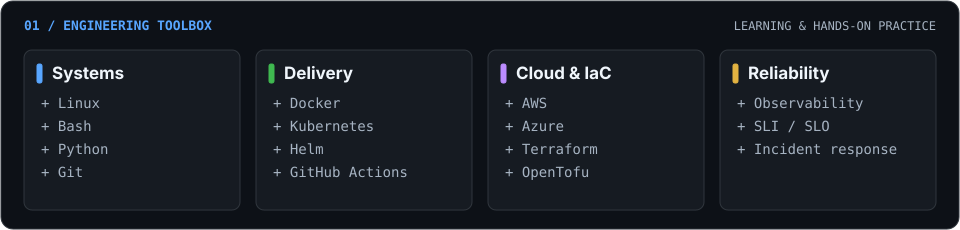
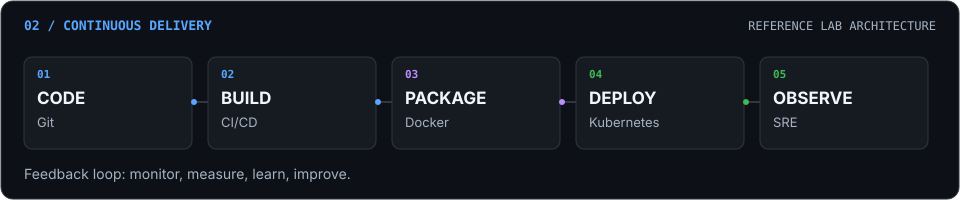
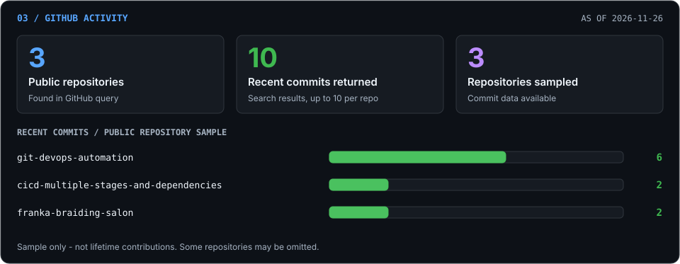
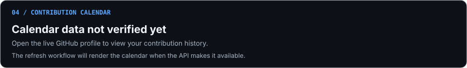

  
  
<a href="https://github.com/ArmelGuezt?tab=repositories">Repositories</a> | <a href="https://github.com/ArmelGuezt?tab=overview">GitHub activity</a>

## About me

Technology professional with a background in digital product design, agile delivery and software engineering, transitioning toward DevOps, Cloud Infrastructure and Site Reliability Engineering (SRE).

I combine product thinking with hands-on engineering practice, focusing on infrastructure automation, continuous delivery, observability and reliable systems.

> Build. Automate. Scale. Keep it reliable.

## Engineering toolbox

## Continuous delivery

## Selected public projects

| Repository | Area |
| :--- | :--- |
| [git-devops-automation](https://github.com/ArmelGuezt/git-devops-automation) | Git and DevOps automation |
| [cicd-multiple-stages-and-dependencies](https://github.com/ArmelGuezt/cicd-multiple-stages-and-dependencies) | Multi-stage CI/CD pipelines |
| [franka-braiding-salon](https://github.com/ArmelGuezt/franka-braiding-salon) | Web project |

## GitHub activity

Statistics are dated and updated by GitHub Actions when enabled. Public repository metrics exclude private repository details. The calendar, when available, reflects GitHub's reported contribution visibility.

## Engineering roadmap

| Track | Learning and practice |
| :--- | :--- |
| DevOps | Repeatable CI/CD and container workflows |
| Cloud and IaC | Terraform, OpenTofu and infrastructure provisioning |
| Kubernetes | Local clusters, Helm and deployment patterns |
| SRE | Observability, reliability objectives and incident learning |

---

LEARN. BUILD. DOCUMENT. IMPROVE.

