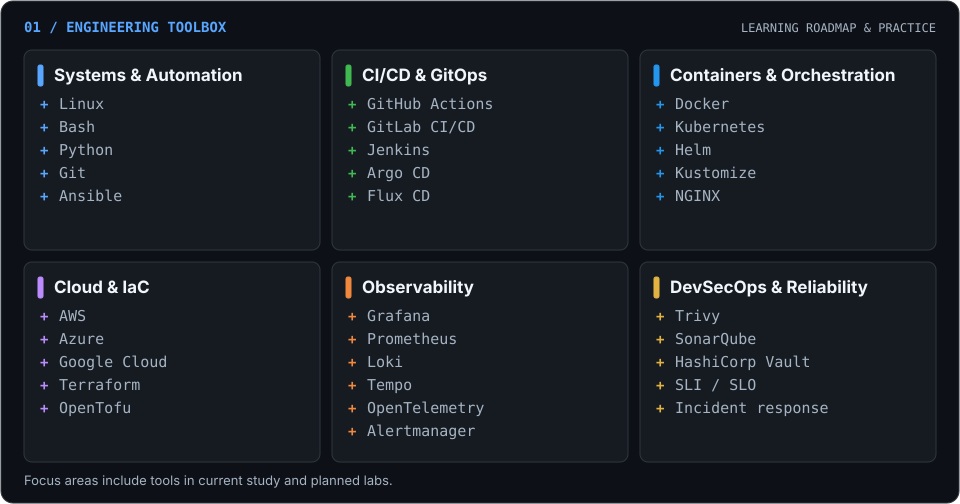
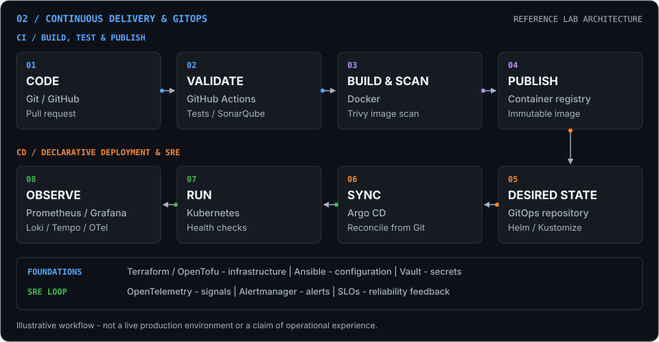

  

## About me

Technology professional with a background in digital product design, agile delivery and software engineering, transitioning toward DevOps, Cloud Infrastructure and Site Reliability Engineering (SRE).

I combine product thinking with hands-on engineering practice, focusing on infrastructure automation, continuous delivery, observability and reliable systems.

> Build. Automate. Scale. Keep it reliable.

## Engineering toolbox

Technology focus includes current learning, hands-on practice and planned labs.

## Continuous delivery

Reference architecture for learning: CI validates and publishes an image; GitOps manages desired state; Argo CD reconciles Kubernetes; telemetry informs reliability improvements.

## Engineering roadmap

| Track | Learning and practice |
| :--- | :--- |
| DevOps | Repeatable CI/CD, container workflows and image security |
| Cloud and IaC | Terraform, OpenTofu, Ansible and infrastructure provisioning |
| Kubernetes & GitOps | Local clusters, Helm, Kustomize and Argo CD |
| SRE | Prometheus, Grafana, OpenTelemetry, SLOs and incident learning |
| DevSecOps | Trivy, SonarQube and secrets management |

---

LEARN. BUILD. DOCUMENT. IMPROVE.

